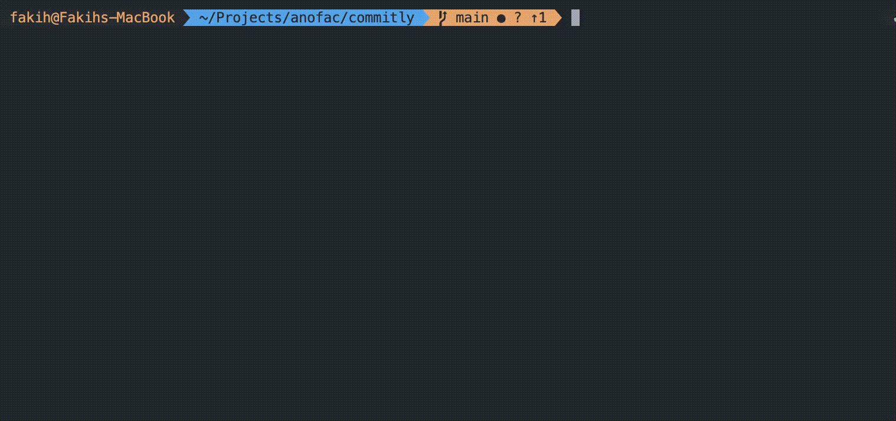

# commitly

Write [Conventional Commits](https://www.conventionalcommits.org/) without
thinking about the format. In your terminal, or as `git cm`.



You know the message you want. The hard part is remembering whether it's
`feat(api):` or `feat: api`, where the space goes, and whether this counts as a
breaking change. Commitly turns that into a menu: pick a type, pick a scope,
type the subject. A live preview shows the exact message before you commit it.

It's one static binary with no runtime and no config file. Everything runs
offline — nothing is ever uploaded.

## Install

**Homebrew** (macOS and Linux)

```sh
brew tap fakihariefnoto/tap
brew install fakihariefnoto/tap/commitly
```

**Go**

```sh
go install github.com/fakihariefnoto/commitly/cmd/commitly@latest
commitly init     # offers the `git cm` alias
```

**Or grab a binary.** Download the archive for your platform from the
[releases page](https://github.com/fakihariefnoto/commitly/releases) and put
`commitly` on your `$PATH`. It includes shell completions and a man page.

## Use it

```sh
git cm                    # compose a commit
git cm -a                 # pick files to stage first
commitly lint --range origin/main..HEAD
commitly changelog        # release notes since the last tag
commitly status           # what you've committed across every repo
commitly serve            # the same history in a browser
```

The commit flow asks for type, scope, subject, whether it breaks anything, and
an optional body. `Esc` goes back a step. `Enter` on the preview commits.

Every prompt has a flag equivalent, so the same command works in a script:

```sh
git cm --type fix --scope api --message "handle empty scope list"
```

Without a terminal — a pipe, CI, a hook — missing values are an error instead
of a hanging prompt. `COMMITLY_NO_TUI=1` forces that path even on a terminal.

## Commands

| Command | What it does |
|---|---|
| `commitly commit` (`git cm`) | Compose and create a commit |
| `commitly status` (`st`) | Your recent commits across every repo |
| `commitly serve` | The same history in a browser, read-only on localhost |
| `commitly lint` | Check a message, a commit, or a range (exit `3` on failure) |
| `commitly changelog` (`cl`) | Markdown release notes from conventional history |
| `commitly init` | Optional extras: alias, hook, completions, starter config |
| `commitly config` | `get` / `set` / `list` / `path` |
| `completion` · `man` · `version` | Generated artifacts and version info |

## The `git cm` trick

One binary, two names. Git resolves `git cm` to any `git-cm` on your `$PATH`, so
the Homebrew formula installs a symlink and commitly notices when it was invoked
that way. No alias, no setup, `git cm` just works.

`go install` can't create a symlink, which is the one case where `commitly init`
offers a `git config --global alias.cm` instead.

## Scopes

A scope labels the area a change touches: `feat(api):`, `fix(cli):`. It's
optional, and commitly only asks when the repo has scopes configured.

Set them from the CLI — this writes a `.commitly.yaml` in the repo:

```sh
commitly config set scope.values api,cli,web --local
```

Or write the file yourself, with descriptions that show up in the menu:

```yaml
scope:
  values:
    - { name: api, description: The command-line surface }
    - { name: tui, description: Terminal UI and rendering }
  mode: list        # list | free | auto | off
```

You can also add one mid-commit: pick **"+ Add new scope…"**, type the name, and
it's used for this commit and saved for next time.

| `scope.mode` | What happens |
|---|---|
| `list` | Pick from `values` with the arrow keys |
| `free` | Type any scope |
| `auto` | Pre-filled from the changed file paths |
| `off` | Never asked |

## The commit-msg hook

`commitly init --all` installs a hook that runs `commitly lint` on **every**
commit in the repo — including ones made with plain `git commit`. Messages that
don't conform get rejected with the specific violation, so the convention holds
even when someone forgets to use the tool.

The hook does two things, and you can turn the second off:

- **Validate** — always on, unless the hook isn't installed.
- **Count** — feeds `commitly status --stats` with date, repo, conforming
  yes/no, type, and whether it was yours. No message text, no SHA, no paths.
  This is spelled out in full before the hook is installed.

```sh
commitly config set stats.count_from_hook false    # keep validation, stop counting
```

If a `.git/hooks/commit-msg` already exists and wasn't written by commitly,
`init` won't overwrite it — use `--force`, or add the check to your hook
yourself. `core.hooksPath` is respected, so a shared `.githooks/` directory
works.

## Configuration

Config comes from five places, highest wins:

1. A flag — `--type fix`
2. The environment — `COMMITLY_SUBJECT__MAX_LENGTH=100`
3. Repo config — `.commitly.yaml`, nearest one walking up
4. User config — `~/.config/commitly/config.yaml`
5. Built-in defaults

When a setting seems ignored, ask which source won:

```sh
commitly config get subject.max_length      # prints the value and where it came from
commitly config set subject.max_length 100 --local
commitly config list --sources              # everything, with provenance
commitly config path                        # where the files live
```

Personal settings (`history:`, `stats:`, `serve:`) are ignored in a repo config,
so cloning a repo can never change how your own activity is recorded. Unknown
keys warn instead of failing, so an older binary still works with a repo pinned
to a newer version.

## Your data

`status` and `serve` read from two files in the OS state directory:

| File | Holds | Written by | Kept |
|---|---|---|---|
| `history.jsonl` | Subjects, SHAs, repo paths | Commits made **through** commitly | Newest 100 |
| `stats.jsonl` | Daily counters only | commitly **and** the hook | ~2 years |

`status --stats` adds volume, type mix, rhythm and how often you stuck to the
convention, for this week, month, or all time. Each number says which window it
covers. `--clear` and `--clear-stats` wipe the two files separately.

Neither file is ever uploaded. `history.jsonl` is written `0600`.

### Drafts

Abort a commit with `Ctrl-C`, or have a hook reject your message, and what you
typed is saved to `.git/COMMITLY_DRAFT`. The next `git cm` offers to restore it —
never automatically. It lives inside `.git/`, so it can't be committed or show
up in `git status`.

- `Y` restores it, `n` skips it, `d` discards it
- `--no-draft` skips the check entirely, for scripts
- Empty junk drafts are discarded on their own
- A successful commit deletes it

## Exit codes

Stable API, for CI and scripts.

| Code | Meaning |
|---|---|
| `0` | Success |
| `1` | The operation failed — not a repo, nothing staged, git rejected it |
| `2` | Bad invocation — unknown flag, missing value on a non-TTY |
| `3` | Validation failed — `lint` found an error |
| `130` | Aborted with `Ctrl-C` (draft saved, index untouched) |

## Updating

Use whatever installed it: `brew upgrade commitly` or
`go install ...@latest`. There's no `commitly self-update` on purpose — it would
fight your package manager.

## License

MIT
